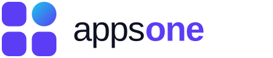
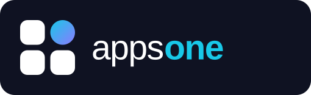
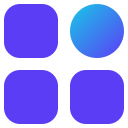
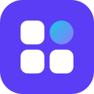
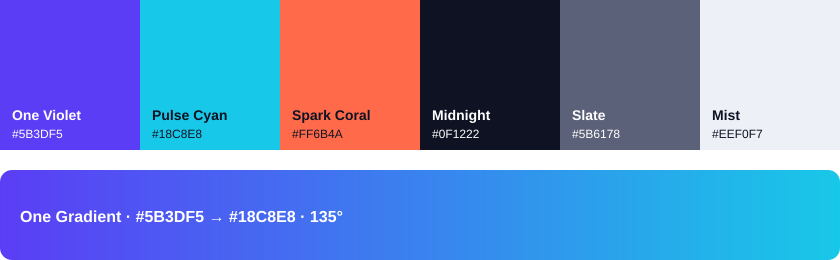

<p align="center">
  
</p>

<h1 align="center">Manual de Marca</h1>
<p align="center"><strong>Tu app, lista o a medida.</strong><br>Versión 1.0 · Octubre 2026</p>

---

## Índice

0. [Cómo usar este manual](#0-cómo-usar-este-manual)
1. [Esencia de marca](#1-esencia-de-marca)
2. [Logotipo](#2-logotipo)
3. [Color](#3-color)
4. [Tipografía](#4-tipografía)
5. [Elementos gráficos](#5-elementos-gráficos)
6. [Componentes de interfaz](#6-componentes-de-interfaz)
7. [Tono y voz](#7-tono-y-voz)
8. [Aplicaciones](#8-aplicaciones)
9. [Accesibilidad](#9-accesibilidad)
10. [Recursos, checklist y control de versiones](#10-recursos-checklist-y-control-de-versiones)

---

## 0. Cómo usar este manual

Este manual reúne las reglas que hacen que **Apps One** se vea, suene y se sienta igual en cualquier lugar: en el portal, en una publicación de redes sociales, en una propuesta comercial o en una tarjeta de presentación.

**¿Para quién es?**
- Personas del equipo que crean contenido, diseñan o programan el portal.
- Agencias, freelancers y proveedores que trabajen con la marca.
- Desarrolladores que publiquen sus apps en el portal y quieran mencionar a Apps One.

**Regla de oro:** si una situación no está cubierta aquí, elige siempre la opción **más simple, más clara y con más espacio en blanco**. Ante la duda, consulta con el equipo de marca (ver [sección 10](#10-recursos-checklist-y-control-de-versiones)).

---

## 1. Esencia de marca

### 1.1 Qué es Apps One

Apps One es un portal donde cualquier persona o empresa encuentra la aplicación que necesita: **lista para usar** o **desarrollada a medida**. Un solo lugar ("one") para todas las soluciones digitales.

### 1.2 Propósito

> **Hacer que tener la app correcta sea simple para todos.**

### 1.3 Misión

Conectar a personas y empresas con aplicaciones de calidad, ya sea eligiendo una solución lista en nuestro catálogo o construyendo una a medida, con un proceso transparente, rápido y sin tecnicismos.

### 1.4 Visión

Ser el portal de referencia en Latinoamérica para encontrar, comprar y crear aplicaciones.

### 1.5 Valores

| Valor | Qué significa | Cómo se nota |
|---|---|---|
| **Simplicidad** | Quitamos la complejidad técnica del camino del cliente. | Procesos en pocos pasos, lenguaje claro, interfaces limpias. |
| **Confianza** | Lo que mostramos es lo que entregamos. | Precios visibles, reseñas reales, plazos cumplidos. |
| **Calidad** | Cada app del catálogo pasa por una revisión. | Sello "Verificada por Apps One", soporte posventa. |
| **Cercanía** | Hablamos como personas, no como manual técnico. | Tuteo, ejemplos concretos, atención humana. |
| **Innovación** | Buscamos siempre la mejor forma de resolver. | Catálogo actualizado y nuevas tecnologías aplicadas con criterio. |

### 1.6 Personalidad

Si Apps One fuera una persona, sería **una experta en tecnología que te explica todo como una buena amiga**: segura, optimista, resolutiva y sin arrogancia.

| Somos | Pero no somos |
|---|---|
| Expertos | Pedantes |
| Cercanos | Informales en exceso |
| Optimistas | Exagerados |
| Ágiles | Apresurados |
| Modernos | Pasajeros o "de moda" |

**Arquetipo:** *El Creador* (transforma ideas en soluciones reales), con rasgos de *El Sabio* (guía y asesora con conocimiento).

### 1.7 Público objetivo

| Segmento | Quiénes son | Qué necesitan | Mensaje clave |
|---|---|---|---|
| **Compradores de apps listas** | Emprendedores, pymes y profesionales independientes. | Una solución rápida, probada y con precio claro. | "Encuentra tu app y empieza hoy." |
| **Clientes de desarrollo a medida** | Empresas medianas y grandes, startups y áreas internas. | Una solución específica, con un equipo confiable y plazos claros. | "Cuéntanos tu idea; la construimos contigo." |
| **Desarrolladores aliados** | Estudios y desarrolladores que venden en el portal. | Visibilidad, ventas y un canal confiable. | "Tu app, frente a quienes la necesitan." |

### 1.8 Propuesta de valor

**Para** personas y empresas que necesitan una aplicación,
**Apps One es** el portal que reúne apps listas para usar y desarrollo a medida
**que** te permite resolver tu necesidad en un solo lugar,
**a diferencia de** buscar entre tiendas dispersas o agencias sin referencias,
**porque** cada app y cada proyecto cuentan con precios transparentes, revisión de calidad y acompañamiento real.

### 1.9 Eslogan y mensajes

- **Eslogan principal:** *Tu app, lista o a medida.*
- **Eslóganes alternativos** (para campañas):
  - *Todas las apps. Un solo lugar.*
  - *La app que necesitas está aquí. Y si no, la creamos.*
  - *De la idea a la app.*
- **Pilares de comunicación:**
  1. **Encuentra:** catálogo amplio, buscador inteligente y categorías claras.
  2. **Elige con confianza:** reseñas, demos, precios visibles y apps verificadas.
  3. **Crea a medida:** cotización simple, equipo experto y seguimiento del proyecto.

---

## 2. Logotipo

<p align="center">
  
</p>

### 2.1 Concepto

El isotipo es un **mosaico de cuatro módulos**, como la pantalla de inicio de un teléfono. Tres módulos son cuadrados de esquinas redondeadas (las apps) y uno es un **círculo con degradado**: *la app que es para ti*, la "one".

- El cuadrado representa estructura, orden y catálogo.
- El círculo representa a la persona, la solución exacta y lo hecho a medida.
- El degradado de cian a violeta representa la transformación de una idea en una app.

El logotipo se escribe en minúsculas, **"apps one"**, para transmitir cercanía. La palabra *one* va en peso extra bold y en color violeta, porque es la promesa de la marca.

### 2.2 Construcción

El logotipo se construye sobre una unidad **x**, que equivale al lado de un módulo del isotipo.

```
 ┌─────┐   ╭─────╮
 │  x  │   │  ●  │      x = lado de un módulo
 └─────┘   ╰─────╯      separación entre módulos = 0,22x
 ┌─────┐   ┌─────┐      radio de las esquinas = 0,3x
 │     │   │     │      separación isotipo–texto = 0,6x
 └─────┘   └─────┘      altura de la x del texto ≈ 0,9x
```

- El isotipo completo mide **2,22x × 2,22x**.
- El texto "apps one" se alinea verticalmente al centro del isotipo.

### 2.3 Versiones

| Versión | Uso | Archivo |
|---|---|---|
| **Principal (horizontal)** | Uso preferente en fondos claros: web, documentos, presentaciones. | [`assets/logo-principal.svg`](assets/logo-principal.svg) |
| **Negativo** | Fondos oscuros (Midnight) o fotografías oscuras. | [`assets/logo-negativo.svg`](assets/logo-negativo.svg) |
| **Monocromática** | Impresión a una tinta, grabados, sellos, fax o documentos legales. | [`assets/logo-monocromo.svg`](assets/logo-monocromo.svg) |
| **Isotipo** | Espacios reducidos, avatares y marcas de agua. | [`assets/logo-isotipo.svg`](assets/logo-isotipo.svg) |
| **Ícono de app / favicon** | Ícono de la app móvil, favicon y perfiles en redes sociales. | [`assets/icono-app.svg`](assets/icono-app.svg) |

<p align="center">
  
  &nbsp;&nbsp;
  
  &nbsp;&nbsp;
  
</p>

> **Nota técnica:** los archivos SVG usan la tipografía Plus Jakarta Sans. Antes de enviarlos a imprenta o a terceros, **convierte el texto a contornos** (en Illustrator, Figma o Inkscape) para que se vea igual en cualquier equipo.

### 2.4 Zona de protección

Alrededor del logotipo debe quedar un espacio libre mínimo de **1x** por cada lado. En ese espacio no puede haber textos, imágenes, bordes ni otros logos.

```
        ← 1x →
   ┌───────────────────────────┐
   │                           │ ↑ 1x
   │   [■ ●]  apps one         │
   │   [■ ■]                   │
   │                           │ ↓ 1x
   └───────────────────────────┘
```

### 2.5 Tamaños mínimos

| Versión | Digital | Impreso |
|---|---|---|
| Logotipo horizontal | 96 px de ancho | 25 mm de ancho |
| Isotipo | 16 px | 6 mm |
| Ícono de app | 16 px (favicon) | No aplica |

### 2.6 Fondos permitidos

| Fondo | Versión a usar |
|---|---|
| Blanco o Mist (#EEF0F7) | Principal |
| Midnight (#0F1222) | Negativo |
| One Violet (#5B3DF5) | Negativo, con el texto completamente en blanco |
| Fotografía clara y limpia | Principal, en un área sin elementos |
| Fotografía oscura o recargada | Negativo, sobre una capa de Midnight al 60 % |

### 2.7 Usos incorrectos

No se debe:

1. ❌ Deformar, estirar o comprimir el logotipo.
2. ❌ Rotarlo o inclinarlo.
3. ❌ Cambiar sus colores o aplicar otros degradados.
4. ❌ Cambiar la tipografía o escribirlo como "AppsOne", "APPS ONE" o "Apps1".
5. ❌ Reordenar los módulos del isotipo o mover el círculo a otra posición.
6. ❌ Agregar sombras, contornos, brillos o efectos 3D.
7. ❌ Colocarlo sobre fondos sin contraste suficiente (por ejemplo, el logo principal sobre Pulse Cyan).
8. ❌ Encerrarlo en formas que no sean las del ícono oficial.
9. ❌ Usar la versión principal sobre fondo oscuro.
10. ❌ Separar el isotipo y el texto con distancias distintas a la de la construcción.

### 2.8 Escritura del nombre en textos

- En textos corridos: **Apps One** (con mayúsculas iniciales y separado).
- En el logotipo: **apps one** (minúsculas; solo en la pieza gráfica).
- No se traduce ni se abrevia. Como abreviatura interna se acepta **A1**, pero nunca de cara al cliente.

### 2.9 Convivencia con otras marcas (co-branding)

- El logotipo de Apps One y el de la marca aliada deben tener la **misma altura visual**.
- Se separan con una línea vertical de 1 px en Slate (#5B6178), con una distancia de 1x a cada lado.
- Para apps de terceros publicadas en el portal se usa el sello **"Disponible en Apps One"**: el isotipo más el texto en Inter Semibold.

---

## 3. Color

<p align="center">
  
</p>

### 3.1 Paleta principal

| Color | Rol | HEX | RGB | CMYK | Pantone (aprox.) |
|---|---|---|---|---|---|
| **One Violet** | Color de marca, botones principales y enlaces | `#5B3DF5` | 91, 61, 245 | 63, 75, 0, 4 | 2725 C |
| **Pulse Cyan** | Acento tecnológico, degradados y detalles sobre fondo oscuro | `#18C8E8` | 24, 200, 232 | 90, 14, 0, 9 | 306 C |
| **Midnight** | Textos principales y fondos oscuros | `#0F1222` | 15, 18, 34 | 56, 47, 0, 87 | Black 6 C |

### 3.2 Paleta secundaria

| Color | Rol | HEX | RGB | CMYK | Pantone (aprox.) |
|---|---|---|---|---|---|
| **Spark Coral** | Ofertas, novedades y elementos que deben llamar la atención | `#FF6B4A` | 255, 107, 74 | 0, 58, 71, 0 | 171 C |
| **Slate** | Textos secundarios y descripciones | `#5B6178` | 91, 97, 120 | 24, 19, 0, 53 | 7545 C |
| **Mist** | Fondos de secciones, tarjetas y separadores | `#EEF0F7` | 238, 240, 247 | 4, 3, 0, 3 | 663 C |
| **White** | Fondo principal | `#FFFFFF` | 255, 255, 255 | 0, 0, 0, 0 | — |

> Los valores CMYK y Pantone son referenciales. Valídalos siempre con una prueba de color de la imprenta.

### 3.3 Degradado de marca: One Gradient

- **De** One Violet `#5B3DF5` **a** Pulse Cyan `#18C8E8`, a 135°.
- **Usos:** el círculo del isotipo, banners principales (hero), portadas, fondos de campañas y elementos destacados.
- **No usar en:** textos de cuerpo, íconos pequeños ni botones secundarios.
- **CSS:** `background: linear-gradient(135deg, #5B3DF5 0%, #18C8E8 100%);`

### 3.4 Proporción de uso (60 / 30 / 10)

```
████████████████████████████████████  60 %  White + Mist (fondos y aire)
██████████████████                    30 %  Midnight + Slate (texto y estructura)
██████                                10 %  One Violet, Pulse Cyan y Spark Coral (acción y acento)
```

Spark Coral nunca debe superar el **5 %** de una pieza. Es un acento y pierde fuerza si se usa en exceso.

### 3.5 Escala tonal de One Violet (para interfaces)

| Token | HEX | Uso sugerido |
|---|---|---|
| violet-50 | `#F2EFFF` | Fondos de selección |
| violet-100 | `#E4DEFE` | Fondos de badges y hover suave |
| violet-200 | `#C9BDFC` | Bordes activos |
| violet-300 | `#A894FA` | Ilustraciones |
| violet-400 | `#8B7BFF` | Texto y enlaces en modo oscuro |
| **violet-500** | **`#5B3DF5`** | **Color base** |
| violet-600 | `#4A2DE0` | Hover de botón primario |
| violet-700 | `#3B22B8` | Botón presionado |
| violet-800 | `#2D1A8C` | Textos sobre fondos violeta claros |
| violet-900 | `#1F1261` | Fondos profundos |

### 3.6 Colores funcionales (estados del sistema)

| Estado | HEX | Uso |
|---|---|---|
| Éxito | `#16A34A` | Pago confirmado, descarga completa |
| Advertencia | `#F59E0B` | Suscripción por vencer |
| Error | `#DC2626` | Errores de formulario o de pago |
| Información | `#2563EB` | Mensajes informativos |

Los colores funcionales **no son colores de marca**: no se usan en publicidad ni en piezas decorativas.

### 3.7 Combinaciones de contraste aprobadas

| Texto / fondo | Contraste | Resultado |
|---|---|---|
| Midnight sobre White | 18,6 : 1 | ✅ AAA, cualquier tamaño |
| White sobre One Violet | 6,1 : 1 | ✅ AA, cualquier tamaño |
| Slate sobre White | 6,1 : 1 | ✅ AA, cualquier tamaño |
| One Violet sobre Mist | 5,4 : 1 | ✅ AA, cualquier tamaño |
| Pulse Cyan sobre Midnight | 9,3 : 1 | ✅ AAA, cualquier tamaño |
| Midnight sobre Spark Coral | 6,6 : 1 | ✅ AA, cualquier tamaño |
| violet-400 sobre Midnight | 5,6 : 1 | ✅ AA, cualquier tamaño |
| One Violet sobre Midnight | 3,0 : 1 | ⚠️ Solo títulos grandes (24 px o más) |
| White sobre Spark Coral | 2,8 : 1 | ❌ No usar |
| Pulse Cyan sobre White | 2,0 : 1 | ❌ No usar para texto |

### 3.8 Modo oscuro

| Elemento | Modo claro | Modo oscuro |
|---|---|---|
| Fondo | White `#FFFFFF` | Midnight `#0F1222` |
| Superficie (tarjetas) | Mist `#EEF0F7` | `#1A1E33` |
| Texto principal | Midnight | `#F5F6FA` |
| Texto secundario | Slate | `#A3A9C2` |
| Acción principal | One Violet | violet-400 `#8B7BFF` |
| Acento | Spark Coral | Pulse Cyan |

### 3.9 Tokens para desarrollo (CSS)

```css
:root {
  --ao-violet: #5B3DF5;
  --ao-violet-hover: #4A2DE0;
  --ao-cyan: #18C8E8;
  --ao-coral: #FF6B4A;
  --ao-midnight: #0F1222;
  --ao-slate: #5B6178;
  --ao-mist: #EEF0F7;
  --ao-white: #FFFFFF;
  --ao-gradient: linear-gradient(135deg, #5B3DF5 0%, #18C8E8 100%);

  --ao-success: #16A34A;
  --ao-warning: #F59E0B;
  --ao-error: #DC2626;
  --ao-info: #2563EB;
}
```

---

## 4. Tipografía

### 4.1 Familias

| Rol | Familia | Pesos | Por qué |
|---|---|---|---|
| **Títulos y marca** | [Plus Jakarta Sans](https://fonts.google.com/specimen/Plus+Jakarta+Sans) | 500, 700, 800 | Geométrica, moderna y con personalidad. Es la del logotipo. |
| **Textos e interfaz** | [Inter](https://fonts.google.com/specimen/Inter) | 400, 500, 600 | Muy legible en pantalla y en tamaños pequeños. |
| **Datos y código** | [JetBrains Mono](https://fonts.google.com/specimen/JetBrains+Mono) | 400, 500 | Versiones, fragmentos de código y datos técnicos. |

Las tres son gratuitas (licencia Open Font License) y están disponibles en Google Fonts.

**Alternativas del sistema** (cuando no se pueden instalar fuentes, por ejemplo en correos u Office):
- Títulos: **Segoe UI Bold** (Windows) o **Helvetica Neue Bold** (Mac).
- Textos: **Segoe UI** o **Arial**.
- Código: **Consolas** o **Courier New**.

### 4.2 Jerarquía tipográfica

| Estilo | Familia | Peso | Tamaño / interlínea | Tracking | Uso |
|---|---|---|---|---|---|
| Display | Plus Jakarta Sans | 800 | 56 / 64 px | -2 % | Hero del portal, portadas |
| H1 | Plus Jakarta Sans | 800 | 40 / 48 px | -1,5 % | Título de página |
| H2 | Plus Jakarta Sans | 700 | 32 / 40 px | -1 % | Secciones |
| H3 | Plus Jakarta Sans | 700 | 24 / 32 px | -0,5 % | Subsecciones y nombres de app |
| H4 | Plus Jakarta Sans | 700 | 20 / 28 px | 0 | Títulos de tarjeta |
| Cuerpo grande | Inter | 400 | 18 / 28 px | 0 | Introducciones y destacados |
| Cuerpo | Inter | 400 | 16 / 24 px | 0 | Texto general |
| Pequeño | Inter | 400 | 14 / 20 px | 0 | Descripciones y metadatos |
| Leyenda | Inter | 500 | 12 / 16 px | +1 % | Notas y textos legales |
| Overline | Inter | 600 | 12 / 16 px, MAYÚSCULAS | +8 % | Etiquetas de categoría |
| Botón | Inter | 600 | 16 / 24 px | 0 | Botones y enlaces de acción |
| Precio | Plus Jakarta Sans | 800 | Variable | -1 % | Precios en tarjetas y fichas |

En móvil, reduce Display, H1 y H2 en un **25 %** aproximadamente (Display 40 px, H1 32 px, H2 26 px).

### 4.3 Reglas de uso

- Los títulos van en **tipo oración**: "Encuentra tu próxima app", no "Encuentra Tu Próxima App".
- Las líneas de texto deben tener entre **60 y 80 caracteres** como máximo.
- Alinea los textos a la izquierda. El centrado solo se usa en títulos cortos y piezas de redes sociales.
- No uses más de **tres tamaños** de letra en una misma pieza gráfica.
- No subrayes para destacar: usa **negrita** o color One Violet.
- Evita las MAYÚSCULAS sostenidas, salvo en etiquetas tipo overline.

---

## 5. Elementos gráficos

### 5.1 Patrón "Mosaico"

El patrón de marca nace del isotipo: una retícula de módulos (cuadrados redondeados y círculos) que se repite.

- **Uso:** fondos de portadas, banners, papelería y merchandising.
- **Reglas:**
  - Usa módulos en Mist sobre White, o en `#1A1E33` sobre Midnight (patrón sutil).
  - Solo **uno** de cada 8 a 12 módulos puede ser un círculo con One Gradient, como guiño al logo.
  - El patrón nunca debe competir con el texto. Deja siempre un área limpia para el mensaje.

### 5.2 Formas y radios

Los bordes redondeados son parte de la identidad, porque recuerdan a los íconos de apps.

| Token | Radio | Uso |
|---|---|---|
| radius-sm | 8 px | Inputs, badges y chips |
| radius-md | 12 px | Botones y tarjetas pequeñas |
| radius-lg | 16 px | Tarjetas de app y modales |
| radius-xl | 24 px | Íconos de app, banners y contenedores destacados |
| radius-full | 999 px | Avatares e indicadores circulares |

### 5.3 Espaciado

Sistema basado en múltiplos de **4 px**: `4 · 8 · 12 · 16 · 24 · 32 · 48 · 64 · 96`.
- Separación interna mínima de una tarjeta: 16 px (móvil) y 24 px (escritorio).
- Separación entre secciones del portal: 64 a 96 px.

### 5.4 Sombras y profundidad

Las sombras son suaves y tienen un leve tinte violeta, nunca negro puro.

```css
--ao-shadow-sm: 0 1px 2px rgba(15, 18, 34, 0.06);
--ao-shadow-md: 0 4px 16px rgba(91, 61, 245, 0.08);
--ao-shadow-lg: 0 12px 32px rgba(91, 61, 245, 0.14);
```

### 5.5 Iconografía

- **Estilo:** lineal (outline), con trazo de **2 px** y extremos redondeados.
- **Retícula:** 24 × 24 px, con 2 px de margen interno.
- **Base recomendada:** [Lucide](https://lucide.dev) o [Phosphor](https://phosphoricons.com) en estilo regular, para mantener coherencia.
- **Color:** Midnight o Slate por defecto, y One Violet cuando el ícono está activo o seleccionado.
- **Íconos de categoría del portal:** dentro de un contenedor de 48 px con radio de 12 px y fondo violet-50.
- No mezcles íconos rellenos y lineales en una misma vista.

### 5.6 Fotografía

**Sí:**
- Personas reales usando dispositivos en contextos cotidianos (oficina, tienda, hogar, terreno).
- Luz natural, ambientes luminosos y espacios ordenados.
- Diversidad de edades, géneros y tipos de negocio.
- Pantallas con interfaces reales o maquetas limpias.

**No:**
- Fotos de stock genéricas o forzadas (personas señalando pantallas vacías, apretones de mano).
- Código "matrix" o fondos con ceros y unos.
- Filtros saturados, viñetas o blanco y negro dramático.

**Tratamiento:** se puede aplicar un velo de One Gradient al 20 % en modo multiplicar para unificar piezas de campaña.

### 5.7 Ilustración

- Estilo **plano y geométrico**, construido con los mismos módulos del logo (cuadrados redondeados y círculos).
- Paleta limitada a los colores de marca y la escala violeta.
- Personajes simples, sin rasgos faciales detallados.
- Útil para estados vacíos, onboarding, errores (404) y explicaciones de procesos.

### 5.8 Maquetas de dispositivos (mockups)

- Usa marcos de dispositivo minimalistas, en color Midnight o gris muy claro.
- Inclina los dispositivos como máximo 15°, con sombras suaves (shadow-lg).
- Nunca muestres pantallas con datos personales reales.

### 5.9 Movimiento (motion)

- **Personalidad:** ágil y suave. Las cosas "encajan" como módulos en su lugar.
- **Duraciones:** 150 ms (microinteracciones), 250 ms (componentes) y 400 ms (transiciones de página).
- **Curva:** `cubic-bezier(0.2, 0.8, 0.2, 1)`.
- **Animación de logo:** los cuatro módulos aparecen en secuencia (arriba a la izquierda, abajo a la izquierda, abajo a la derecha) y al final el círculo crece con un leve rebote.
- Respeta la preferencia `prefers-reduced-motion`: si la persona la tiene activa, se desactivan las animaciones no esenciales.

---

## 6. Componentes de interfaz

Guía base para el diseño y desarrollo del portal.

### 6.1 Botones

| Tipo | Estilo | Uso |
|---|---|---|
| **Primario** | Fondo One Violet, texto blanco, radio de 12 px, alto de 48 px | Acción principal: "Comprar", "Cotizar mi app" |
| **Secundario** | Fondo blanco, borde de 1,5 px en One Violet, texto One Violet | Acción alternativa: "Ver demo" |
| **Terciario** | Solo texto en One Violet, con subrayado al pasar el cursor | Acciones menores: "Ver más" |
| **Destacado** | Fondo One Gradient, texto blanco en peso 700 | Solo una vez por página, en el hero o en un CTA de campaña |
| **Peligro** | Fondo Error `#DC2626`, texto blanco | Acciones destructivas: "Cancelar suscripción" |

**Estados:** hover (violet-600), presionado (violet-700), foco (anillo de 3 px en violet-200) y deshabilitado (Mist con texto `#A3A9C2`).

**Textos de botón:** verbos en infinitivo o imperativo, de dos a tres palabras. Por ejemplo: "Comprar ahora", "Probar gratis", "Cotizar proyecto".

### 6.2 Tarjeta de app (componente principal del catálogo)

```
┌──────────────────────────────────────┐
│  ╭────╮                     [NUEVO]  │  ← ícono de 56 px (radio 16) + badge
│  │icon│  Nombre de la App            │  ← H4
│  ╰────╯  Categoría · Desarrollador   │  ← Pequeño, en Slate
│                                      │
│  Descripción breve en dos líneas     │  ← Cuerpo, en Slate (máx. 2 líneas)
│  como máximo, con puntos suspensivos │
│                                      │
│  ★ 4,8 (320)   ✓ Verificada          │  ← Metadatos
│ ──────────────────────────────────── │
│  $29.990 /mes          [ Ver app ]   │  ← Precio (Plus Jakarta 800) + botón
└──────────────────────────────────────┘
   Fondo blanco · radio de 16 px · borde 1 px Mist · shadow-md al pasar el cursor
```

### 6.3 Badges y etiquetas

| Badge | Fondo | Texto | Uso |
|---|---|---|---|
| **Nuevo** | Spark Coral | Midnight | Apps publicadas hace menos de 30 días |
| **Popular** | violet-100 | violet-800 | Apps más vendidas |
| **Verificada** | `#DCFCE7` | `#166534` | Apps que pasaron la revisión de calidad |
| **A medida** | Midnight | Pulse Cyan | Servicios de desarrollo personalizado |
| **Oferta** | Spark Coral | Midnight | Descuentos vigentes |

### 6.4 Formularios

- Inputs de 48 px de alto, borde de 1 px en `#D5D8E5`, radio de 8 px y etiqueta siempre visible sobre el campo.
- Al tener el foco: borde en One Violet y anillo violet-100.
- Los mensajes de error van debajo del campo, en color Error, con un ícono y un texto que explique cómo corregirlo.
- El formulario de "Cotizar app a medida" debe tener como máximo **5 campos** en el primer paso.

---

## 7. Tono y voz

### 7.1 Principios de la voz

| Principio | Qué significa | Ejemplo |
|---|---|---|
| **Claro** | Explicamos sin tecnicismos. Si usamos un término técnico, lo aclaramos. | "Tu app funcionará en iPhone y Android." |
| **Cercano** | Tuteamos y hablamos de persona a persona. | "Cuéntanos qué necesitas y te ayudamos." |
| **Seguro** | Afirmamos con fundamento y sin prometer de más. | "Entregamos tu primera versión en 6 semanas." |
| **Positivo** | Nos enfocamos en lo que sí se puede hacer. | "Aún no tenemos esa app, pero podemos crearla para ti." |

### 7.2 Decimos / no decimos

| ✅ Decimos | ❌ No decimos |
|---|---|
| "Encuentra la app que necesitas." | "Explore nuestro amplio portafolio de soluciones de software." |
| "Te enviamos la cotización en 48 horas." | "Nos pondremos en contacto a la brevedad." |
| "Algo salió mal con el pago. Revisa los datos de tu tarjeta e inténtalo de nuevo." | "Error 402: transacción rechazada." |
| "Tu app, lista o a medida." | "Soluciones digitales end-to-end de clase mundial." |
| "Sin costos ocultos." | "¡¡La mejor oferta del universo!!" |
| "Desarrollamos tu app con tecnología actual y segura." | "Usamos un stack serverless con microservicios en Kubernetes." (salvo que la audiencia sea técnica) |

### 7.3 La voz según el canal

| Canal | Tono | Ejemplo |
|---|---|---|
| **Portal web** | Claro, directo y orientado a la acción | "Más de 500 apps listas para usar. Encuentra la tuya." |
| **Redes sociales** | Cercano, dinámico, con humor ligero | "¿Sigues anotando pedidos en un cuaderno? 📒 Hay una app para eso." |
| **Propuestas comerciales** | Profesional, concreto y con datos | "Proponemos un desarrollo en tres etapas, con entregas cada dos semanas." |
| **Soporte** | Empático, paciente y resolutivo | "Entiendo lo que pasó. Lo revisamos ahora mismo y te escribo en menos de una hora." |
| **Correos transaccionales** | Breve e informativo | "¡Listo! Tu compra de *Agenda Pro* está confirmada." |
| **Mensajes de error** | Tranquilo, sin culpar a la persona y con una solución | "No encontramos resultados para 'facturasion'. ¿Quisiste decir 'facturación'?" |

### 7.4 Microcopy del portal

| Situación | Texto recomendado |
|---|---|
| Buscador vacío | "¿Qué quieres resolver hoy? Ej.: reservas, inventario, ventas…" |
| Sin resultados | "No encontramos esa app… todavía. [Cotiza una a medida]" |
| Carrito vacío | "Tu carrito está esperando su primera app." |
| Compra exitosa | "¡Listo! Ya puedes usar tu app. Te enviamos los accesos a tu correo." |
| Error 404 | "Esta página se perdió entre tantas apps. [Volver al inicio]" |
| Cotización enviada | "¡Recibimos tu idea! Te contactaremos en menos de 48 horas." |

### 7.5 Reglas de redacción

- **Tuteo** en todos los canales, salvo en documentos legales y contratos.
- **Lenguaje inclusivo:** preferimos términos neutros ("las personas usuarias", "quienes compran", "el equipo") en vez de desdoblamientos con "@" o "x".
- **Precios:** en moneda local, con punto como separador de miles y sin decimales innecesarios (por ejemplo, $29.990). Indica siempre si incluyen impuestos y la periodicidad (/mes, /año, pago único).
- **Números:** del uno al nueve se escriben con letras en textos corridos, y del 10 en adelante con cifras. En la interfaz se usan siempre cifras.
- **Emojis:** solo en redes sociales y como máximo dos por publicación. Nunca en propuestas ni en mensajes de error.
- **Signos de exclamación:** como máximo uno por mensaje.
- **Anglicismos:** se aceptan los que son de uso común (app, demo, login), pero se evitan cuando existe una palabra clara en español (descarga, no *download*; panel, no *dashboard*, salvo en contextos técnicos).

### 7.6 Glosario de marca

| Usamos | En vez de |
|---|---|
| App | Software, aplicativo |
| Desarrollo a medida | Desarrollo custom, software bespoke |
| Cotización | Presupuesto formal, RFQ |
| Catálogo | Marketplace (en textos de cara al cliente) |
| Equipo de Apps One | La empresa, nosotros como corporación |
| Personas usuarias / clientes | Usuarios finales, consumidores |

---

## 8. Aplicaciones

### 8.1 Portal web

- **Header:** logo principal a la izquierda (altura de 32 px), buscador al centro y "Cotizar app" como botón primario a la derecha.
- **Hero:** fondo blanco con el patrón Mosaico sutil, título Display en Midnight con la palabra clave en One Violet y un botón destacado con One Gradient.
- **Catálogo:** grilla de tarjetas de app (4 columnas en escritorio, 2 en tablet y 1 en móvil).
- **Footer:** fondo Midnight con el logo en negativo.
- **Favicon:** [`assets/icono-app.svg`](assets/icono-app.svg), exportado también en PNG de 32 y 180 px.

### 8.2 Redes sociales

| Formato | Medidas | Uso |
|---|---|---|
| Post cuadrado | 1080 × 1080 px | Feed de Instagram, Facebook y LinkedIn |
| Post vertical | 1080 × 1350 px | Feed de Instagram, recomendado por su mayor alcance |
| Historia / Reel | 1080 × 1920 px | Historias, Reels y TikTok |
| Portada de LinkedIn | 1584 × 396 px | Perfil de empresa |
| Foto de perfil | 400 × 400 px | Ícono de app (versión violeta) |

**Reglas para las piezas:**
- Margen de seguridad del 8 % por lado; en historias, deja libres los 250 px superiores e inferiores.
- El logo (isotipo o versión horizontal) va siempre en la **esquina inferior derecha** o centrado abajo.
- Un mensaje principal por pieza, de máximo 8 palabras.
- **Líneas de contenido sugeridas:**
  1. **"Hay una app para eso"**: problemas cotidianos y la app que los resuelve.
  2. **"App de la semana"**: destacado del catálogo.
  3. **"Hecho a medida"**: casos de éxito de desarrollos personalizados.
  4. **"Tech sin enredos"**: tips y explicaciones simples.

### 8.3 Correo electrónico y firma

**Plantilla de correo:**
- Ancho de 600 px, header blanco con el logo principal (160 px de ancho) y cuerpo en Arial o Segoe UI de 16 px.
- Un solo botón primario por correo, en One Violet.
- Footer en Mist con enlaces a redes sociales y la opción para darse de baja.

**Firma:**

```
Nombre Apellido
Cargo · Apps One
+56 9 0000 0000 · nombre@appsone.com
appsone.com
[isotipo 24 px]  Tu app, lista o a medida.
```

- Nombre en Arial Bold 14 px, color Midnight. Cargo y datos en Arial 12 px, color Slate.
- Sin frases célebres, banners pesados ni colores fuera de la paleta.

> Los datos de contacto y el dominio son ejemplos. Reemplázalos por los oficiales cuando estén definidos.

### 8.4 Presentaciones (formato 16:9)

- **Portada:** fondo Midnight o One Gradient, logo en negativo, título en Plus Jakarta Sans 800 y fecha en Inter.
- **Diapositivas de contenido:** fondo blanco, título H2 arriba a la izquierda e isotipo de 24 px abajo a la derecha.
- **Separadores de sección:** fondo One Violet con un número grande en Pulse Cyan.
- **Cierre:** "Gracias" más el eslogan y los datos de contacto.
- Máximo **6 líneas** de texto por diapositiva. Prefiere los gráficos y las capturas de pantalla.
- **Gráficos:** usa el orden de colores One Violet → Pulse Cyan → Spark Coral → Slate → violet-300.

### 8.5 Papelería

| Pieza | Medidas | Especificaciones |
|---|---|---|
| **Tarjeta de presentación** | 85 × 55 mm | Frente: fondo Midnight con el logo en negativo centrado. Reverso: blanco, con nombre, cargo y datos alineados a la izquierda, y un círculo con One Gradient en la esquina. Papel de 350 g, mate. |
| **Hoja carta / A4** | 216 × 279 mm / 210 × 297 mm | Logo arriba a la izquierda (30 mm), pie de página con datos en Slate y una franja inferior de 3 mm con One Gradient. |
| **Sobre** | Americano o DL | Logo principal arriba a la izquierda y el remitente en Inter 9 pt. |
| **Carpeta** | A4 | Fondo One Violet con el patrón Mosaico y el logo en negativo. |

### 8.6 Ficha de app en el portal (para desarrolladores aliados)

Reglas que deben cumplir las apps publicadas para mantener un catálogo coherente:
- **Ícono:** 512 × 512 px, sin textos, con fondo sólido o degradado propio (no se exige usar la paleta de Apps One).
- **Capturas:** de 3 a 8 imágenes en 1290 × 2796 px (móvil) o 1920 × 1080 px (web).
- **Nombre:** máximo 30 caracteres.
- **Descripción corta:** máximo 80 caracteres y con un beneficio claro.
- **Video demo:** opcional, de 30 a 60 segundos.
- El sello **"Disponible en Apps One"** solo se usa en apps aprobadas y en su versión oficial.

### 8.7 Merchandising

- **Poleras y polerones:** prenda de color Midnight con el isotipo en el pecho (8 cm) y el eslogan en la espalda.
- **Tazas, botellas y libretas:** isotipo a todo color sobre fondo blanco, o versión monocromática en grabado.
- **Stickers:** el isotipo troquelado y el círculo con One Gradient por separado ("Sé la one").
- **Tote bags:** patrón Mosaico en una tinta.

### 8.8 Publicidad digital

- **Banners display:** 300×250, 728×90, 320×50 y 160×600 px.
- **Estructura:** logo + mensaje (máximo 6 palabras) + botón. El botón ocupa como mínimo el 15 % del alto del banner.
- **Google Ads (texto):** usa los pilares de comunicación: *Encuentra*, *Elige con confianza* y *Crea a medida*.

---

## 9. Accesibilidad

Apps One es para **todas las personas**, por eso la accesibilidad no es opcional.

- Cumple como mínimo el estándar **WCAG 2.2 nivel AA**.
- El contraste mínimo es de **4,5 : 1** para el texto normal y de **3 : 1** para el texto grande y los íconos (ver [3.7](#37-combinaciones-de-contraste-aprobadas)).
- **Nunca uses solo el color** para transmitir información: acompáñalo con un ícono o un texto (por ejemplo, ✓ Verificada).
- Las áreas táctiles deben medir al menos **44 × 44 px**.
- Todas las imágenes llevan un **texto alternativo** descriptivo, y las decorativas usan `alt=""`.
- El foco del teclado debe verse siempre (anillo de 3 px en violet-200).
- Los videos incluyen subtítulos, y las piezas de redes sociales con texto en la imagen repiten ese texto en la descripción.
- El tamaño mínimo de texto en la interfaz es de 14 px (12 px solo en leyendas).

---

## 10. Recursos, checklist y control de versiones

### 10.1 Archivos de marca

| Archivo | Ubicación |
|---|---|
| Logotipo principal | [`assets/logo-principal.svg`](assets/logo-principal.svg) |
| Logotipo en negativo | [`assets/logo-negativo.svg`](assets/logo-negativo.svg) |
| Logotipo monocromático | [`assets/logo-monocromo.svg`](assets/logo-monocromo.svg) |
| Isotipo | [`assets/logo-isotipo.svg`](assets/logo-isotipo.svg) |
| Ícono de app / favicon | [`assets/icono-app.svg`](assets/icono-app.svg) |
| Paleta de colores | [`assets/paleta.svg`](assets/paleta.svg) |
| Tipografías | [Google Fonts: Plus Jakarta Sans, Inter y JetBrains Mono](https://fonts.google.com) |

**Archivos pendientes de producir** (recomendado para la versión 1.1):
- Logos en PNG con fondo transparente (@1x, @2x y @3x) y en PDF/EPS con el texto convertido a contornos.
- Plantillas de presentación (PowerPoint y Google Slides).
- Plantillas de redes sociales (Figma o Canva).
- Kit de interfaz en Figma con los componentes de la sección 6.

### 10.2 Checklist antes de publicar

- [ ] ¿El logo es la versión correcta para el fondo y respeta su zona de protección?
- [ ] ¿El logo supera el tamaño mínimo?
- [ ] ¿Los colores son exactamente los de la paleta (HEX, CMYK o Pantone según el medio)?
- [ ] ¿Se respeta la proporción 60/30/10 y Spark Coral ocupa menos del 5 %?
- [ ] ¿Se usaron Plus Jakarta Sans e Inter (o las alternativas aprobadas)?
- [ ] ¿Hay un solo mensaje principal y una sola acción principal?
- [ ] ¿El texto está en tuteo, es claro y no tiene tecnicismos innecesarios?
- [ ] ¿Pasa la verificación de contraste AA?
- [ ] ¿Las imágenes tienen texto alternativo?
- [ ] ¿Se revisaron la ortografía, los precios y los datos de contacto?

### 10.3 Contacto de marca

Para dudas, aprobaciones o solicitudes de archivos:
**Equipo de Marca Apps One** · marca@appsone.com *(correo de ejemplo; reemplázalo por el oficial)*

### 10.4 Control de versiones

| Versión | Fecha | Cambios |
|---|---|---|
| 1.0 | Octubre 2026 | Primera versión: identidad visual, logotipo, color, tipografía, tono, componentes y aplicaciones. |

---

<p align="center">
  <br>
  <sub><strong>Apps One</strong> · Tu app, lista o a medida.</sub>
</p>
